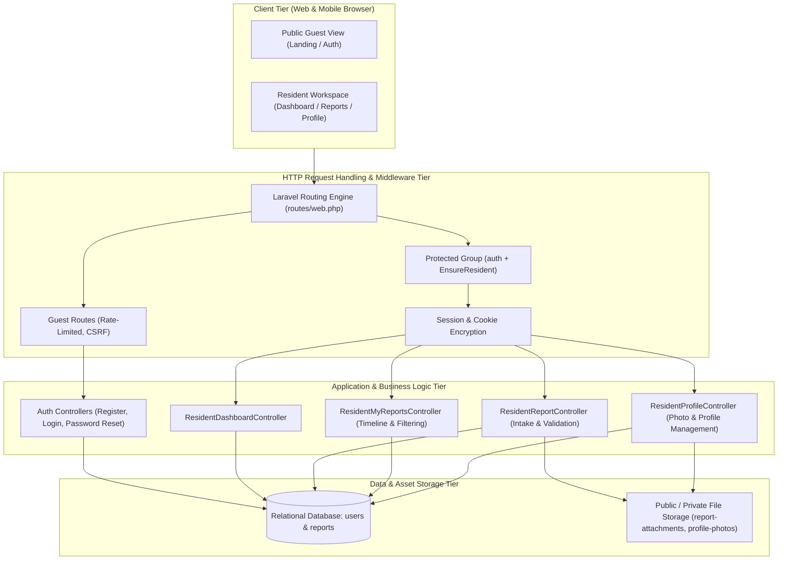
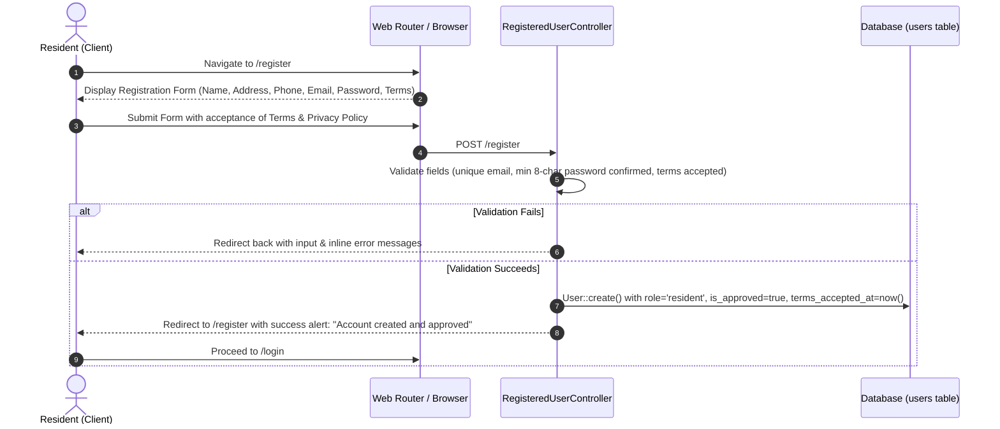
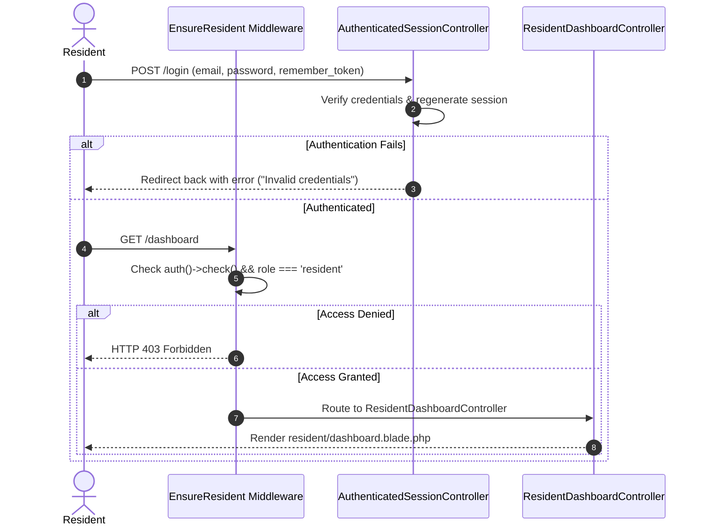
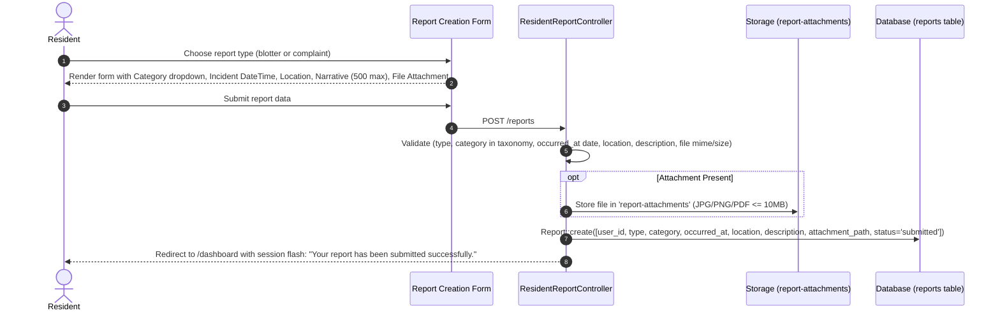
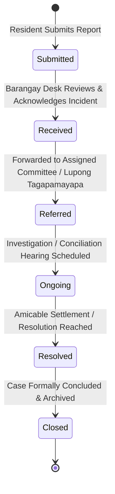
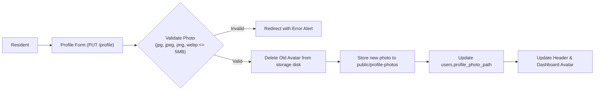
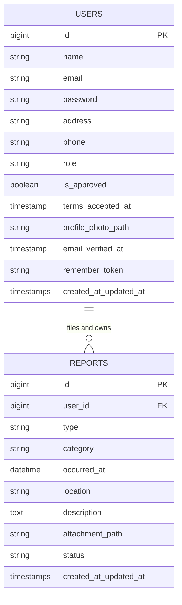

# Technical & System Design Document
## Barangay Ward II — Blotter & Community Monitoring System

---

**Document Control**
- **Document Version:** 1.0.0 (Release Specification)
- **Project Name:** Barangay Ward II Blotter and Resident Monitoring Portal
- **Framework & Runtime:** Laravel 12.x / PHP 8.2+ / Vite / MySQL / Blade
- **Architecture Pattern:** Model-View-Controller (MVC) with Role-Based Access Control (RBAC)
- **Status:** Active / Production Scaffold
- **Primary Repository:** `e:\Xampp\htdocs\Barangay-website`

---

## 1. Executive Summary & System Objectives

The **Barangay Ward II Blotter and Community Monitoring System** is an e-governance platform engineered to streamline incident reporting, community blotter documentation, and civic concern resolution between residents and barangay officials.

### 1.1 Core Objectives
1. **Digitize Incident & Blotter Intake:** Transition from physical logbooks to an auditable, timestamped digital ledger for blotter records and community concerns.
2. **Transparent Resident Tracking:** Empower residents with a self-service tracking interface with real-time status progression (`Submitted` → `Received` → `Referred` → `Ongoing` → `Resolved` → `Closed`).
3. **Data Integrity & Confidentiality:** Ensure compliance with the **Philippine Data Privacy Act of 2012 (RA 10173)** through secure authentication, server-enforced role gates, encrypted sessions, and isolated per-resident record boundaries.
4. **Accessible Public Service:** Provide a mobile-first, responsive, and intuitive interface reflecting the official identity and seal of Barangay Ward II.

---

## 2. System Architecture & High-Level Topology

The system is architected as a modular monolithic Laravel web application designed to run seamlessly on standard local government infrastructure (such as local XAMPP/WAMP stacks or containerized cloud servers).



---

## 3. Core Actors & Role Matrix

The platform enforces strict role-based separation:

| Actor / Persona | Responsibility | Access Permissions |
| :--- | :--- | :--- |
| **Guest / Visitor** | Browses public services, about info, contacts, and starts reporting entry point. | Public landing (`/`), Login (`/login`), Registration (`/register`), Password Reset (`/forgot-password`). |
| **Verified Resident** | Submits Blotter Reports, logs Community Concerns, tracks personal submission statuses, manages contact info & avatar. | Full access to Resident Dashboard (`/dashboard`), Report creation (`/reports/create`), My Reports (`/my-reports`), and Profile (`/profile`). Strictly restricted from accessing other residents' reports. |
| **Barangay Administration / Secretary** *(Roadmap / Future Phase)* | Evaluates submitted reports, updates incident lifecycle stages, refers cases to Lupong Tagapamayapa, and schedules blotter conciliation hearings. | Administrative dashboard, report intake queue, timeline transitions, official blotter export. |

---

## 4. End-to-End System Flows

The system is built upon five foundational workflows. All flows are preserved and strictly modeled after the production implementation.

### 4.1 Flow 1: Resident Registration & Auto-Approval


### 4.2 Flow 2: Resident Authentication & Route Protection


### 4.3 Flow 3: Incident Report Intake (Blotter vs. Complaint)
The resident initiates an incident from either the landing page CTA or the protected dashboard card choices:
- **Card A (Red Theme):** Blotter Report (`/reports/create?type=blotter`)
- **Card B (Teal Theme):** Complaint / Incident Report (`/reports/create?type=complaint`)



### 4.4 Flow 4: Status Lifecycle & Timeline Tracking ("My Reports")
Every submitted incident generates a reference code in the format `CR-XXXX` (where `XXXX` is zero-padded report ID). Residents review their history and monitor progress through an interactive linear timeline.



#### Timeline Step States
| Step Number | Stage Name | Visual State | Description |
| :---: | :--- | :--- | :--- |
| **1** | **Submitted** | Complete / Current | Incident details successfully captured by the system. |
| **2** | **Received** | Ongoing Transition | Assigned desk officer acknowledges and confirms case receipt. |
| **3** | **Referred** | Transition | Docket referred to the appropriate barangay officer or committee. |
| **4** | **Ongoing** | Transition | Active investigation, mediation, or physical inspection in progress. |
| **5** | **Resolved** | Transition | Resolution issued or compromise agreement executed. |
| **6** | **Closed** | Final State | Final blotter entry closed and archived into municipal records. |

### 4.5 Flow 5: Resident Profile & Avatar Management
Residents can update their display name and upload a personalized profile picture that synchronizes across the top navigation bar and resident dashboard.



---

## 5. Database Schema & Data Dictionary

### 5.1 Entity-Relationship Model


### 5.2 Table Specifications

#### Table: `users`
| Column Name | Data Type | Nullable | Default | Description / Constraints |
| :--- | :--- | :---: | :---: | :--- |
| `id` | `BIGINT UNSIGNED` | No | Auto | Primary Key |
| `name` | `VARCHAR(255)` | No | — | Full resident name |
| `email` | `VARCHAR(255)` | No | — | Unique resident login identifier |
| `password` | `VARCHAR(255)` | No | — | Bcrypt-hashed authentication password |
| `address` | `VARCHAR(255)` | Yes | `NULL` | Residence address (Purok / Sitio / Street) |
| `phone` | `VARCHAR(30)` | Yes | `NULL` | Contact phone / mobile number |
| `role` | `VARCHAR(255)` | No | `'resident'` | Access tier (`resident`, `secretary`) |
| `is_approved` | `TINYINT(1)` | No | `1` | Approval state for system access |
| `terms_accepted_at`| `TIMESTAMP` | Yes | `NULL` | Audit timestamp of terms agreement |
| `profile_photo_path`| `VARCHAR(255)` | Yes | `NULL` | Relative storage path for profile picture |
| `remember_token` | `VARCHAR(100)` | Yes | `NULL` | Session persistence token |
| `created_at` / `updated_at` | `TIMESTAMP` | Yes | `NULL` | Standard Eloquent audit timestamps |

#### Table: `reports`
| Column Name | Data Type | Nullable | Default | Description / Constraints |
| :--- | :--- | :---: | :---: | :--- |
| `id` | `BIGINT UNSIGNED` | No | Auto | Primary Key (Base for Reference `CR-XXXX`) |
| `user_id` | `BIGINT UNSIGNED` | No | — | Foreign Key (`users.id`) on delete cascade |
| `type` | `VARCHAR(255)` | No | — | Classification: `'blotter'` or `'complaint'` |
| `category` | `VARCHAR(255)` | No | — | Taxonomy classification (Infrastructure, Peace & Order, etc.) |
| `occurred_at` | `DATETIME` | No | — | Date and time when the incident took place |
| `location` | `VARCHAR(255)` | No | — | Specific venue / street / purok of incident |
| `description` | `TEXT` | No | — | Incident narrative (Max 500 characters) |
| `attachment_path`| `VARCHAR(255)` | Yes | `NULL` | Relative path to uploaded file evidence |
| `status` | `VARCHAR(255)` | No | `'submitted'`| Stage: `submitted`, `received`, `referred`, `ongoing`, `resolved`, `closed` |
| `created_at` / `updated_at` | `TIMESTAMP` | Yes | `NULL` | Submission and modification timestamps |

---

## 6. Official Taxonomy & Category Classification

All reports must be classified under one of the 8 sanctioned barangay administrative categories:

1. **Infrastructure:** Damaged streetlights, drainage blockages, broken sidewalks, public facility hazards.
2. **Peace and Order:** Noise disturbances, neighborhood disputes, curfew violations, public intoxication, minor brawls.
3. **Education:** School zone safety, student welfare concerns, community library or learning center reports.
4. **Profession:** Labor-related community disputes, local business conduct or vendor concerns.
5. **Health:** Sanitation hazards, uncollected refuse, stagnant water breeding vectors, public health advisories.
6. **Kasambahay and Environment:** Household worker welfare, illegal dumping, tree trimming, environmental hazards.
7. **Senior Citizen:** Elderly assistance requests, accessibility hindrances, senior welfare issues.
8. **Other:** Miscellaneous community concerns not covered by standard classifications.

---

## 7. HTTP Route & Controller Catalog

| HTTP Method | URI Pattern | Route Name | Controller & Action | Middleware | Functionality |
| :--- | :--- | :--- | :--- | :--- | :--- |
| `GET` | `/` | — | Inline Closure | `web` | Public homepage with hero section, service cards, and quick login/register portals. |
| `GET` | `/register` | `register` | `RegisteredUserController@create` | `web`, `guest` | Displays resident signup form with terms checkbox. |
| `POST` | `/register` | `register.store` | `RegisteredUserController@store` | `web`, `guest` | Validates signup inputs, creates resident record, auto-approves account. |
| `GET` | `/login` | `login` | `AuthenticatedSessionController@create`| `web`, `guest` | Displays login screen with credentials inputs. |
| `POST` | `/login` | `login.store` | `AuthenticatedSessionController@store` | `web`, `guest` | Authenticates resident, generates session, redirects to dashboard. |
| `GET` | `/forgot-password`| `password.request`| `PasswordResetLinkController@create` | `web`, `guest` | Password recovery request form. |
| `POST` | `/forgot-password`| `password.email` | `PasswordResetLinkController@store` | `web`, `guest` | Issues password reset link token. |
| `GET` | `/reset-password/{token}` | `password.reset` | `NewPasswordController@create` | `web`, `guest` | Password reset execution screen. |
| `POST` | `/reset-password`| `password.update` | `NewPasswordController@store` | `web`, `guest` | Updates resident password. |
| `GET` | `/dashboard` | `resident.dashboard` | `ResidentDashboardController` | `auth`, `EnsureResident` | Resident dashboard with report cards (Blotter / Complaint). |
| `GET` | `/reports/create`| `resident.reports.create`| `ResidentReportController@create` | `auth`, `EnsureResident` | Dynamic report intake form filtered by `?type=blotter` or `?type=complaint`. |
| `POST` | `/reports` | `resident.reports.store` | `ResidentReportController@store` | `auth`, `EnsureResident` | Validates incident data, persists evidence, creates report. |
| `GET` | `/my-reports` | `resident.reports.index` | `ResidentMyReportsController` | `auth`, `EnsureResident` | Paginated/listed report table, deep-dive modal, and linear progress timeline. |
| `GET` | `/profile` | `resident.profile.edit` | `ResidentProfileController@edit` | `auth`, `EnsureResident` | Displays resident profile and photo upload interface. |
| `PUT` | `/profile` | `resident.profile.update` | `ResidentProfileController@update` | `auth`, `EnsureResident` | Updates resident name and uploads avatar image. |
| `POST` | `/logout` | `logout` | `AuthenticatedSessionLogoutController` | `auth` | Invalidates session, regenerates CSRF token, redirects to home. |

---

## 8. UI/UX Design System Specifications

### 8.1 Color Palette & Token Hierarchy
The design system employs an authoritative, civic-oriented navy and sky-blue color palette accented with high-contrast functional status indicators:

```
[ Primary Navy #012D53 ]   [ Gradient Core #07519A ]   [ Action Blue #1375CF ]   [ Sky Tint #EDF7FF ]
[ Blotter Accent #F0143A ] [ Concern Teal #0BB79F ]   [ Warning Gold #805600 ]  [ Closed Gray #526C82 ]
```

| Token | Hex Value | Semantic Usage |
| :--- | :--- | :--- |
| `--navy-900` | `#012d53` | Top navigation background, deep contrast text, footer background. |
| `--navy-800` | `#013d66` | Secondary headers, card container borders. |
| `--navy-600` | `#0b5c8d` | Subtle text labels, icon outlines, active tab borders. |
| `--blue-action`| `#1375cf` | Primary action buttons, active navigation indicator pill. |
| `--sky-bg` | `#edf7ff` | Global body background, application frame background. |
| `--white` | `#ffffff` | Content card surfaces, form inputs, button foreground text. |
| `--blotter-red`| `#f0143a` | Blotter Report card header, border, and urgent badge indicator. |
| `--teal-accent`| `#0bb79f` | Complaint/Concern card header, positive progress timeline indicator. |
| `--gold-status`| `#ffe7af` | Background for `ongoing` investigation state. |

### 8.2 Typography & Layout Tokens
- **Font Family:** `'Plus Jakarta Sans', 'Segoe UI', system-ui, sans-serif`
- **Application Shell:** Max-width 1440px desktop shell with rounded borders (`border-radius: 12px`), drop shadows, and distinct workspace isolation.
- **Responsive Breakpoints:**
  - `Desktop (> 900px):` Fixed 250px sidebar with expanded workspace grid.
  - `Tablet (701px - 900px):` Compact 190px sidebar with condensed table columns.
  - `Mobile (<= 700px):` Single-column top-stack navigation with horizontally scrollable data tables and full-width form inputs.

### 8.3 Status Badge Matrix
- `status-submitted`: Light Sky Blue (`#dcefff`), Text Navy (`#0758a6`)
- `status-received`: Soft Azure (`#d9edff`), Text Navy (`#0758a6`)
- `status-referred`: Soft Azure (`#d9edff`), Text Navy (`#0758a6`)
- `status-ongoing`: Warm Amber (`#ffe7af`), Text Bronze (`#805600`)
- `status-resolved`: Soft Emerald (`#d5f4ed`), Text Forest Teal (`#087362`)
- `status-closed`: Soft Steel (`#e9eff4`), Text Muted Slate (`#526c82`)

---

## 9. Security, Privacy & Integrity Controls

1. **Strict Ownership Boundaries:** In `ResidentMyReportsController`, reports are strictly retrieved using `$request->user()->reports()`. Users can never query or view reports filed by other residents.
2. **Access Control Middleware (`EnsureResident`):** Intercepts every protected request, preventing unauthenticated sessions or mismatched roles from accessing resident workspace routes.
3. **Input Sanitization & Validation:**
   - File uploads strictly restricted to safe extensions (`jpg`, `jpeg`, `png`, `pdf`, `webp`) and capped at 10 MB for reports and 5 MB for avatars.
   - Character length enforcement on incident narratives (max 500 characters) with real-time client-side counting and server-side validation.
4. **Asset Protection:** Uploaded evidence is stored in non-public app storage or isolated subfolders, preventing direct path traversal attacks.
5. **CSRF Enforcement:** All mutable state endpoints (`POST`, `PUT`, `DELETE`) require valid Laravel `@csrf` tokens.

---

## 10. Future Extension Roadmap

- [ ] **Lupong Tagapamayapa Mediation Module:** Support for scheduling physical conciliation summons and recording amicable settlement minutes.
- [ ] **SMS Notification Bridge:** Automated SMS dispatch to residents when report status advances from `Submitted` to `Received` or `Ongoing`.
- [ ] **Barangay Clearance & Certification Issuance:** Digital application and QR-code verification for Barangay Clearance, Certificate of Residency, and Indigency.
- [ ] **Secretary Blotter Analytics:** Geographic heatmaps and category-based incident aggregation for peace and order committee reporting.

---
*Barangay Ward II Information Systems Development Committee • Official Architecture & Design Specification*
